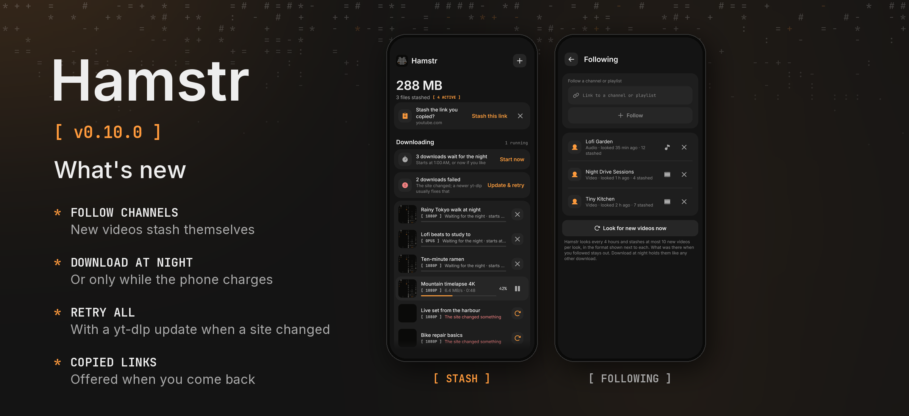

Hamstr 0.10.0 follows channels for you, downloads at night if you like, and says more plainly what your downloads are waiting for.

### Phone and desktop

- **Follow a channel or playlist.** In the + sheet, in a playlist's sheet on the phone, or in Settings › Following. Every four hours Hamstr looks for what is new there and stashes it by itself, at most ten videos per look, as video or as audio. What was there when you followed stays out, and so does anything you already stashed yourself. Followed channels are part of the backup.
- **Download at night.** New downloads wait for the hours you pick (Settings › Queue on the phone, Downloads on the computer); running ones finish. On the phone, *Only while charging* holds them until it is on the charger. The stash says what waits for what, with *Start now* for when you don't want to wait.
- **Retry all.** When several downloads failed, one button tries them all again. When a site changed, it updates yt-dlp first.
- **Your place in line.** Waiting downloads say whether they are next up or how many are ahead of them.
- **Copied links.** Come back to Hamstr with a new link on the clipboard and the stash offers it, once per copy. On Android 12 and later Hamstr only reads the clipboard once you tap *Stash*, so Android doesn't announce a paste every time. It can be switched off in Settings › Downloads.
- **Screen readers.** Everything a swipe does is also in the row's actions (TalkBack's actions menu). Switches say whether they are on, progress is read out, badges without their brackets, and messages are announced.

### Phone

- To start downloads at night, and to look at followed channels while Hamstr is closed, the app now uses an exact alarm (`USE_EXACT_ALARM`), which Android allows to start the download queue from the background. The queue no longer has to wait for hours with a notification up.

On the computer, followed channels are looked at while Hamstr runs, also from the tray.

All 13 languages are included. Cheek stays at 0.3.2. Android's version code increases from 1007 to 1100.

Android and desktop compilation and the automated tests passed locally. The new features have not been tried on a physical phone. The release picture shows the stash and Settings › Following as the shared UI tests draw them, because no device or emulator was connected.
