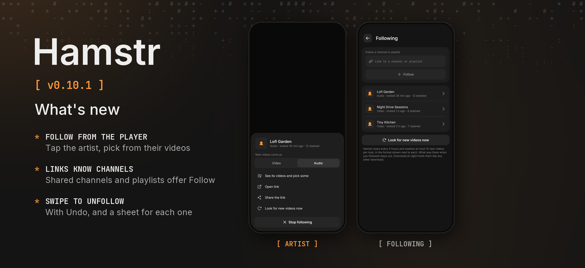

Hamstr 0.10.1 makes following channels easier to reach from where you already are.

### Phone and desktop

- **Following has a sheet of its own.** Tap a followed channel in Settings › Following to choose whether new videos come as video or audio, open or share its link, look for new videos, or stop following.
- **Swipe to stop following.** On the phone a followed channel is swiped away like a download, with Undo; on the computer it has its button at the row's end.
- **Channel and playlist links are recognised.** A shared or pasted link to a channel or playlist (YouTube, YouTube Music, SoundCloud, Bandcamp, TikTok, Twitch) offers *Follow* in the share sheet and the + sheet.
- Followed YouTube channels are called by their name, not "Name - Videos", also the ones followed in 0.10.0.

### Phone

- **Follow from the player.** Tap the artist under the title: the same sheet opens for their channel, with *See its videos and pick some* to choose more of their videos and stash them right away. Downloads remember their channel from now on; for older ones Hamstr looks it up once.
- A shared YouTube channel link lists the channel's newest hundred videos instead of its tabs.

All 13 languages are included. Cheek stays at 0.3.2. Android's version code increases from 1100 to 1101.

Android and desktop compilation and the automated tests passed locally. The changes have not been tried on a physical phone. The release picture shows the artist sheet and Settings › Following as the shared UI tests draw them, because no device or emulator was connected.
