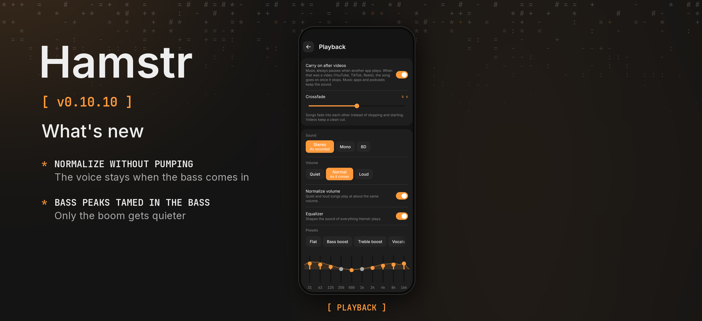

Hamstr 0.10.10 makes *Normalize volume* calm: a song no longer gets quieter and louder again whenever the bass comes in.

### Phone and computer

- **Normalize volume without pumping.** A bass line or a few bass hits no longer turn the whole song down, so a voice that stays the same now sounds the same. Parts that stay louder for a while still come down, within a few seconds.
- **Booming peaks get quieter in the bass only.** When a peak is too loud, only the bass under it is turned down for a moment and the voice stays where it is. This also helps with *Loud* in Settings › Playback.

### Details

Normalizing used to measure the plain energy of the sound over a third of a second and turn the gain down within 50 ms, so every bass section ducked the voice by up to 9 dB and let it back up over seconds. It now weighs the sound like ITU BS.1770, with the bass counting for less still (a high-pass at 100 Hz in the measurement), follows it over seconds (3 s up, 6 s down; the gain 1 s down, 3 s up) and averages the first three seconds of sound instead of starting from nothing. The limiter splits off the bass under 150 Hz and takes what is over the ceiling out of it first, down to a quarter of it, and only the rest out of everything.

Cheek stays at 0.3.2. Android’s version code increases from 1109 to 1110.

New tests play a steady tone with a bass line under it: the old code turned the tone down by 9 dB when the bass came in and by about 4 dB on each bass hit, the new one by less than 1.5 dB and not noticeably. The automated tests passed; the change has not been listened to on a phone or computer with real music. The release picture shows the Playback settings as the shared UI tests draw them, because no device or emulator was connected.
