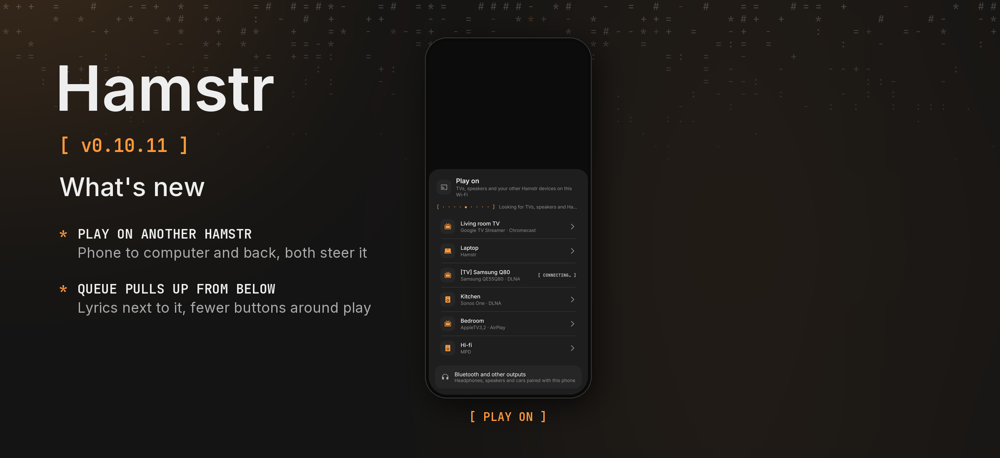

Hamstr 0.10.11 plays on your other Hamstr devices, from the phone to the computer and back, and tidies up the song player on the phone.

### Phone and computer

- **Play on another Hamstr.** *Play on* now lists Hamstr on your computer or another phone next to TVs and speakers, while it is open on the same network. The song or video plays there and both devices can pause, seek and change the volume. A device you haven’t trusted yet asks first; *Always allow* lets it play, and send links and files, without asking.
- **Received files keep their details.** A song or video sent through Nearby arrives with its title, artist and cover instead of only its file name.

### Phone

- **Pull the queue up from below.** The song player has a drawer at its foot with the queue and the lyrics. Pull it up or tap a tab; the song shrinks to one row above it. Pull it down, tap that row or press Back to put it away.
- **Fewer buttons around play.** Under play there are now only the sleep timer, the speed and the equalizer, side by side. *Play on* moved up next to share.
- **Changing the speed keeps the volume steady.** With *Normalize volume* on, a new speed no longer makes the song start over at a different loudness.

### Computer

- **The volume is remembered.** The player starts at the volume you left it at.
- **Smoother seeking.** Jumping, holding the arrow keys and A-B loops no longer stall the player, and a double click on the video seeks from where it is now.
- **Updating shows a window.** While an update installs on Windows, a window says which version is being installed, until the new Hamstr opens.

### Details

“Play on” to another Hamstr goes over Nearby: the sender sends a sealed, signed `play` command (protocol version 2, answered by a signed receipt), serves the file from its media server as for a TV, and the receiver streams it into its own player (FFmpeg on the computer, ExoPlayer through a LAN data source on the phone). Beacons now say whether an app takes such commands, so apps before 0.10.11 don’t show up as devices. Received files carry their metadata and cover in the offer; only media details travel, never paths or ids.

The phone’s song drawer replaces the queue button in the top bar and the lyrics button under the controls; landscape and videos keep their layout. The equalizer’s audio processor now keeps its learned loudness when ExoPlayer flushes it for a speed change. On the computer, the media info is cached per file, the audio device is kept across seeks, the volume is stored in the settings, and an app update no longer replaces a bundled tool (like the Bluetooth helper) that hasn’t changed.

Cheek stays at 0.3.2. Android’s version code increases from 1110 to 1111.

The automated tests run on CI. Nothing of this has been tried on a phone or computer by hand. The release picture shows the *Play on* sheet as the shared UI tests draw it, because no device or emulator was connected.
