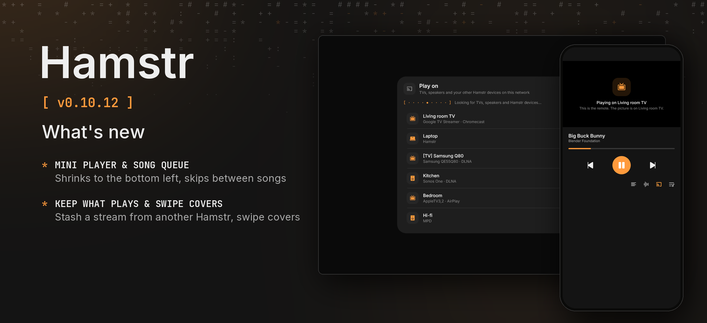

Hamstr 0.10.12 gives the computer a mini player and a song queue, lets you keep a song another Hamstr plays here, and adds cover swiping on the phone.

### Phone and computer

- **Keep what another Hamstr plays.** While another Hamstr plays a song or video on your device, a download button in the player saves the file with its title, artist and cover into your stash.
- **Skip songs across devices.** Pressing previous or next while another Hamstr plays here moves to the previous or next song in its queue, without a pause before the sound starts.

### Phone

- **Swipe the cover to change songs.** Swiping the cover left or right in the song player skips to the next or previous song, with the neighbour’s cover sliding in beside it.

### Computer

- **Mini player at the bottom left.** Clicking outside the player, pressing Esc or clicking the minimize button shrinks the player into a card at the foot of the sidebar instead of stopping playback. Clicking inside the player no longer closes it, and clicking the cover switches it to ASCII art.
- **Previous and next for songs.** Starting a song queues the rest of its playlist or your other songs, and the buttons beside play skip between songs instead of jumping ten seconds.

### Details

When casting to another Hamstr, the sender no longer runs FFmpeg to probe the file first, and the receiver starts audio streams with the duration from the load command instead of running ffprobe over HTTP. On the computer, audio decoding starts with a smaller FFmpeg probe window and writes the first decoded samples to the audio line right away instead of waiting for a full 8 KB read. Downloading a stream fetches the file from the sender’s media server over LAN HTTP and adopts it with its metadata and cached cover.

Cheek stays at 0.3.2. Android’s version code increases from 1111 to 1112.

The automated tests run on CI. Nothing of this has been tried on a phone or computer by hand. The release picture shows the *Play on* sheet and remote player from the shared UI tests, because no device or emulator was connected.
