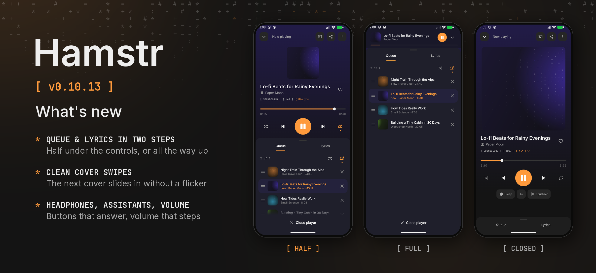

Hamstr 0.10.13 gives the song player’s queue and lyrics a half-open step, makes swiping between covers smooth, lets headphones and assistants reach Hamstr more reliably, and gives the computer a volume slider that steps evenly.

### Phone

- **Queue and lyrics open halfway first.** Tapping Queue or Lyrics under a song opens the sheet halfway: the cover gets smaller, and the title, timeline and play buttons stay above the list. Pull it up, or scroll the list up, to open it all the way; pull it down or press Back to close it. The sheet takes the colour of the cover.
- **No flicker when swiping covers.** Swiping the cover to the next or previous song no longer flashes the old cover back in before the new song starts, and the background colour no longer blinks grey in between.
- **Headphone buttons that answer.** Headphones that send Pause while Hamstr is already paused now start the song, just as a Play while playing already pauses it. A headphone’s Play also starts Hamstr again with the songs that played last, after Hamstr was closed or stopped in the background.
- **Assistants find Hamstr.** Hamstr now shows up as a music app to Gemini, Google Assistant and car screens, so they can list your songs and play what you ask for.

### Computer

- **Volume that steps evenly.** The volume slider now follows how loud things sound: half way is clearly quieter, and the lower half is no longer almost silent. A change glides in instead of clicking.

### Details

The song player’s drawer has three stops (closed, half, full); the half stop sits under the play buttons and the cover shrinks down to 140 dp to make room, and on screens too short for that the drawer keeps two stops. The list and the lyrics move the drawer through nested scrolling. Skipping by a cover swipe or the mini player no longer follows the session’s stale report of the old song for up to 1.2 seconds after the skip, and the cover keeps the neighbours’ pictures so the new cover shows at once.

`PlaybackService` is now a Media3 `MediaLibraryService` and also answers `android.media.browse.MediaBrowserService`, with the library’s songs and videos as browsable items and search through the same matching as voice search. Media3’s `MediaButtonReceiver` is declared and `onPlaybackResumption` restores the last queue, saved whenever the queue or the song changes. On the computer the slider’s level is cubed before it scales the PCM (half way is about −18 dB), and a new gain ramps across one buffer.

Cheek stays at 0.3.2. Android’s version code increases from 1112 to 1113.

The drawer and the cover swipe were tried on an emulator; the media buttons and the volume curve are covered by unit tests. Hamstr appears to the system as a media browser and media button receiver, but asking Gemini or Google Assistant, real Bluetooth headphones, and the volume on a computer were not tried by hand.
