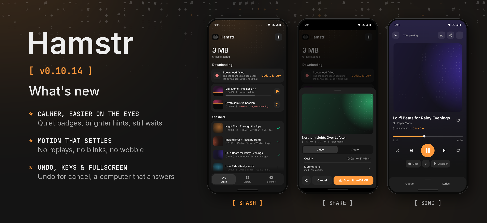

Hamstr 0.10.14 is about how the app feels: calmer lists that are easier on the eyes, motion that settles instead of wobbling, Undo where something could get lost, and a computer app that behaves like one.

### Phone and computer

- **Calmer lists.** Quality badges are quieter and show the best version with a count, so the channel, size and time next to them have room. The green check only shows on files that just arrived and haven’t been played; on the phone the other rows end in a ⋮ that opens their menu. Downloads that wait for Wi-Fi or the night stay still instead of raining characters.
- **Easier to read.** Grey hints, times and subtitles are a little brighter in every background, so small text stays readable on cards, in sheets and in the mini player.
- **Motion that settles.** Titles and checks animate only when something really arrives, not every time you scroll or switch tabs. Pictures you’ve already seen show at once instead of blinking black. A row you swipe away no longer jumps back before it fades, and a row or sheet you let go of returns without swinging past.
- **Undo for cancel.** Cancelling a download shows “Download canceled · Undo” for a few seconds. Until then the download is only paused, so Undo carries on where it was.
- **Plain words.** Messages no longer talk about yt-dlp or FFmpeg, they say what happened, like “An update for Hamstr’s downloader usually fixes it”. The tool names stay in Settings › Engine and under Details. The time a download needs now reads “48 s left”.

### Phone

- **Stashing says it worked.** After “Stash it” in the share sheet, the button turns into a check with “Nom! In the stash” before the sheet closes.
- **A shorter share sheet.** Video or Audio, the quality with its size, and the buttons. Format, subtitles, Open when done and a custom format are behind More options, with a summary of what’s picked.
- **Undo for the player.** Flinging the mini player away keeps its queue for a moment behind “Player closed · Undo”.
- **Messages over sheets.** Messages and their Undo now show over an open sheet, at the top of the screen, instead of hiding behind it.
- **A calmer song page.** The colour taken from the cover is toned down, so bright covers no longer turn the top of the page neon, and the buttons and lyrics there stay readable.
- **Tabs follow your finger.** The highlight in the tab bar moves along with the swipe instead of after it.
- **Skip the intro.** The hamster’s intro stays, but any touch skips it right away, and a hint says so.

### Computer

- **The keyboard reaches everything.** Space plays and pauses, the arrows skip 10 seconds and turn the volume, Shift with an arrow changes the song and M mutes, also with the player down in the corner. Ctrl+N adds a link, Ctrl+F searches the library, and Ctrl+1, 2 and 3 switch tabs. The mouse wheel over the mini player or a volume bar turns the volume.
- **Fullscreen videos.** Press F, click the fullscreen button or double-click the picture. While the video plays, the controls fade away together with the pointer; Esc brings the window back.
- **A window that remembers.** Hamstr opens where you left it, at that size, and maximised if it was. Let go of the title bar at the top of the screen to maximise it, or at a side to fill that half. The close button now reaches the corner of a maximised window.
- **Hover and focus you can see.** Rows and buttons light up under the pointer, the keyboard focus shows a ring, and lists show a thin scroll bar while you scroll. Seek bars grow and show their handle under the pointer.
- **The window answers.** Hiding a file, copying a link or cancelling a download shows a message, with Undo where it fits, and Settings › Hidden brings hidden files back. Dragging a link or files over the window says what letting go will do, and Show all on the stash opens the library.
- **Progress outside the window.** The taskbar button fills while downloads run, the tray icon’s tooltip counts them, and with the window away a notification says when they’re done or one didn’t work.

### Details

This release comes out of a review of how Hamstr looks and feels, with every point checked against the code first. `ghost` is lighter in each base (Graphite #969696) so it reaches at least 4.5:1 on `surface` and `raised`; badges use a new regular-weight mono style (`tag`, 11 sp) in `ghost`. Returns after a drag that didn’t commit use a new spring (`Specs.release`, damping 0.82) that can’t cross zero, with the fling velocity carried over. `DecodeText` remembers which texts it already decoded in this run, and the done check pops only within 3 s of finishing and shows only on files finished in the last 24 h that haven’t been played. Thumbnails sit in a 32 MB memory cache and new ones fade in. A canceled download is paused and hidden (`PendingCancel`) and canceled for real after 8 s; a paused download is now canceled without starting the phone’s download service, so this also works with Hamstr in the background. The notification’s Cancel stays immediate. The song page’s tint keeps saturation at 0.5 or less and luminance at 0.045 or less, and grey covers get none.

On the computer, hover, press and keyboard focus come from one indication for the whole app (focus ring only when the keyboard is used). The window’s place is saved in `window.properties` and only restored when a screen still shows at least half of it. Snapping to the top or a side is done by Hamstr’s own title bar on Windows and Linux; it is not the system’s Aero Snap. Fullscreen covers the screen the window is on (macOS uses its own fullscreen). Taskbar progress uses `java.awt.Taskbar` where the system supports it. 40 new or changed texts are translated into all 13 languages.

Cheek stays at 0.3.2. Android’s version code increases from 1113 to 1114.

The phone, shared and desktop unit tests pass, and the phone screens were looked at on an emulator. The computer’s new window behaviour (snapping, fullscreen, shortcuts, taskbar progress, drag and drop, tray notifications) is built and compiled but was not tried by hand on Windows, macOS or Linux.
