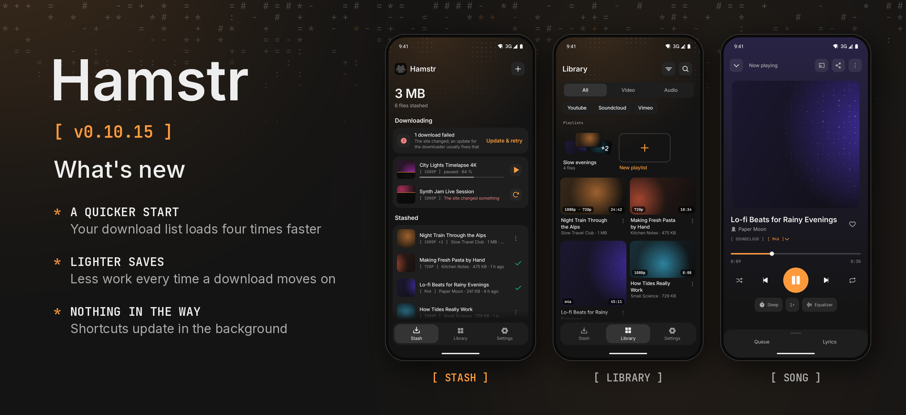

Hamstr 0.10.15 is a quicker Hamstr: it reads and saves your list of downloads with a fraction of the work, and opening or leaving the app on the phone no longer waits for the launcher.

### Phone and computer

- **A quicker start with a long history.** Hamstr reads your list of downloads about four times faster when it opens, so the stash and the library are there sooner. You notice it most with thousands of downloads, for example from followed channels.
- **Lighter saves.** Every time a download starts, finishes or changes, Hamstr saves the list with about a fifth of the work it needed before, which leaves the phone more to spare during long playlist downloads.

### Phone

- **Nothing in the way.** The long-press shortcuts and the launcher icon in your accent are now updated in the background, instead of while Hamstr opens or goes away.

### Details

The download history (`downloads.json`) is now written and read by its own codec (`HistoryJson`) instead of one org.json object per entry. On the desktop JVM, 5000 downloads (about 4 MB) took 77 ms to save and 100 ms to load before, and take 15 ms and 25 ms now; the phone reads the history on its way to the first screen, so it gains there too. The file format stays the same: histories and backups from earlier versions read as before (tested with files org.json wrote, pretty-printed ones, and values of other types the way org.json’s `opt…` calls read them), org.json still reads what it writes, an entry it can’t read is still kept aside, and a damaged file is never read as a shorter list. A progress that isn’t a number no longer makes a save fail, and a lone half of an emoji in a title survives the file. On the phone, `AppIcon.sync` (the 21 launcher entries) and the shortcuts run on a background thread, one at a time, and going to the background again with the same icon asks the package manager nothing.

Before this, the parts that do the heavy work were measured to see whether any of them should move to Rust: the sound chain (equalizer, 8D and normalize together) uses less than 1 % of one core on the computer, file hashes already run in the system’s native crypto code, and downloading and decoding stay in Cheek, FFmpeg and ExoPlayer, which are native already. None of them would gain from Rust, so nothing was moved. Hardware video decoding on the computer would save CPU (H.264 at 1080p: from about 41 % to 17 % of one core) but adds about 450 ms to every start and seek, so it stays off.

Cheek stays at 0.3.2. Android’s version code increases from 1114 to 1115.

The phone, shared and desktop unit tests pass, and the phone screens were looked at on an emulator. How much sooner the app starts on a real phone was not measured.
