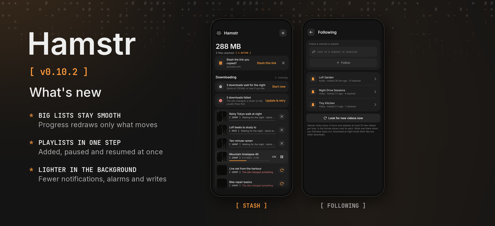

Hamstr 0.10.2 is a bugfix release that keeps Hamstr quick with a long history and big playlists.

### Phone and desktop

- **Big lists stay smooth while downloading.** A running download's progress only redraws its own row, not the whole stash, and FFmpeg's steps move the bar at the same pace as the download.
- **Playlists in one step.** A playlist or season goes on the list at once, and its Pause, Resume, *Retry all* and *Start now* change all its downloads together instead of one after another. Downloads held for the night are marked in one go too.
- **Faster start.** The download history is read alongside the settings, and file checks hash shared files only once and show their results in batches.
- The loading animation and the mark draw with less work each frame.

### Phone

- After a playlist finishes, its files reach the media index in the background, so the next download doesn't wait for it.
- The progress notification and the home screen widget are only updated when what they show changes, and the widget does nothing while none is placed.
- The night and channel alarm is only set again when its time changes.
- Older downloads that were checked once for being audio aren't opened again on every start.

### Desktop

- Settings are saved a moment later on a background thread, so a switch or a slider doesn't wait for the disk; a failed save is tried again, and quitting saves what is pending.

All 13 languages are included. Cheek stays at 0.3.2. Android's version code increases from 1101 to 1102.

Android and desktop compilation and the automated tests passed locally. The changes have not been tried on a physical phone. The release picture shows the stash and Settings › Following as the shared UI tests draw them, because no device or emulator was connected.
