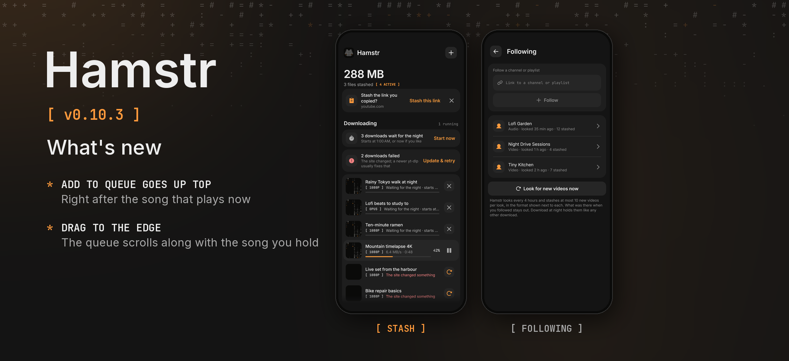

Hamstr 0.10.3 is a bugfix release for the player's queue on the phone.

### Phone

- **Add to queue puts the song up top.** It now comes right after the song that plays now, not after the rest of the album or playlist. More songs added this way line up behind it, in the order they were added; *Play next* still jumps ahead of them all.
- **The queue scrolls while you drag.** Hold a song by its handle and move it to the top or bottom edge of the queue: the list scrolls along, faster the closer you get to the edge, so a song can be moved anywhere in a long queue.

Cheek stays at 0.3.2. Android's version code increases from 1102 to 1103.

Android and desktop compilation and the automated tests passed locally. The changes have not been tried on a physical phone. The release picture shows the stash and Settings › Following as the shared UI tests draw them, because the queue is drawn only on the phone and no device or emulator was connected.
