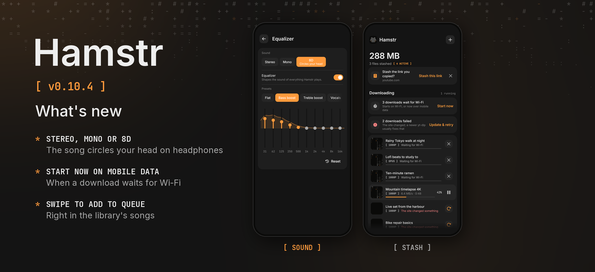

Hamstr 0.10.4 is a bugfix release with two small additions for listening.

### Phone and computer

- **Stereo, mono or 8D.** Settings › Playback (and the equalizer button in the player) has a new *Sound* row above the equalizer. *Mono* gives both ears the same sound, for one earbud or a speaker in the corner. *8D* slowly moves the song once around your head every eight seconds; it is best on headphones. *Stereo* plays it as it was recorded. It works with or without the equalizer and on songs and videos alike.
- **What plays stands out.** Its title is bold and in the accent colour in the stash and the library, so you can find it at a glance; on the phone also in the songs list, playlists and the queue.

### Phone

- **Start now while a download waits for Wi-Fi.** With *Wi-Fi only* on, downloads that wait for Wi-Fi now get a *Start now* in the stash, as a notice above them and as a swipe on each one. Started that way, they download over mobile data and keep going when Wi-Fi comes and goes; the rest still waits for Wi-Fi.
- **Swiping a song to the right in the library adds it to the queue.** It used to play it next. *Play next* is still in each song's menu.

Cheek stays at 0.3.2. Android's version code increases from 1103 to 1104.

Android and desktop compilation and the automated tests passed locally. The changes have not been tried on a physical phone. The release picture shows the stash and the new sound row as the shared UI tests draw them, because no device or emulator was connected.
