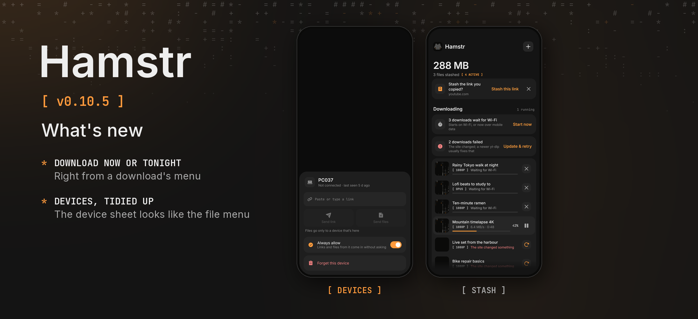

Hamstr 0.10.5 is a bugfix release for the download menu and the device sheet.

### Phone

- **Download now or tonight, from a download's menu.** Hold a download in the stash: *Download now* starts one that waits for the night, the charger or Wi-Fi right away (over mobile data when it waited for Wi-Fi). *Tonight* puts a download off to the night hours from Settings › Queue, even with *Only at night* off; one that is already running stops and picks up where it was once the night begins. *Download now* undoes it.
- **The device sheet looks like the file menu.** Settings › Devices › a device: *Send link* and *Send files* are tiles under the link field, *Always allow* is a switch that says what it does, and *Forget this device* is a red row of its own.

### Computer

- A download put off *Tonight* on the computer's queue waits for the night hours the same way.

Cheek stays at 0.3.2. Android's version code increases from 1104 to 1105.

Android and desktop compilation and the automated tests passed locally. The changes have not been tried on a physical phone. The release picture shows the device sheet and the stash as the shared UI tests draw them, because the download menu is drawn only on the phone and no device or emulator was connected.
