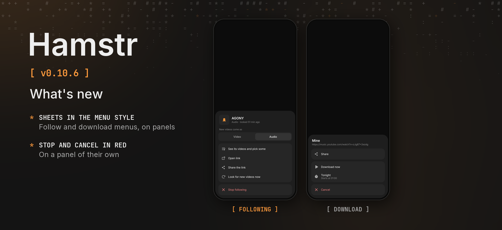

Hamstr 0.10.6 is a bugfix release that brings the follow sheet and a download's menu in line with the rest of the app.

### Phone and computer

- **The follow sheet looks like the file menu.** Hold a channel in Settings › Following, or open a channel from a song: *See its videos and pick some*, *Open link*, *Share the link* and *Look for new videos now* sit together on one panel. *Stop following* is a red row on a panel of its own, and *Follow* stays the orange button.

### Phone

- **A download's menu is grouped too.** While a download is on its way, *Share* and *Try again* share a panel, *Download now* and *Tonight* keep theirs, and *Cancel* is a red row of its own. *Remove from list*, *Copy error* and *Download again* sit on panels as well, instead of loose under the rest.

Cheek stays at 0.3.2. Android's version code increases from 1105 to 1106.

Android and desktop compilation and the automated tests passed locally. The changes have not been tried on a physical phone. The release picture shows the follow sheet and a queued download's menu as the shared UI tests draw them; the download menu is rebuilt there from the same pieces, without its moving preview, because no device or emulator was connected.
