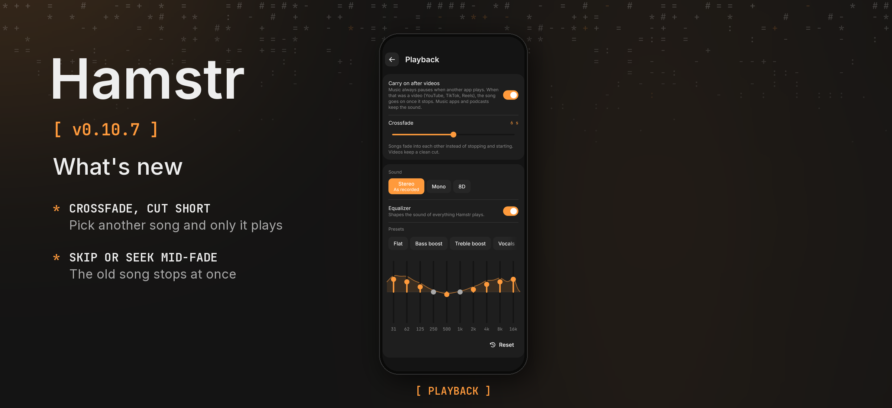

Hamstr 0.10.7 is a bugfix release for the crossfade.

### Phone

- **Picking another song during a crossfade plays only that song.** While two songs faded into each other, starting a different one, skipping or seeking let the old song play on underneath for a few seconds. Now the fade ends at once: the old song stops and the new one plays at full volume.

Cheek stays at 0.3.2. Android's version code increases from 1106 to 1107.

Android and desktop compilation and the automated tests passed locally. The fix has not been tried on a physical phone. The release picture shows the Playback settings with the crossfade as the shared UI tests draw them, because no device or emulator was connected.
