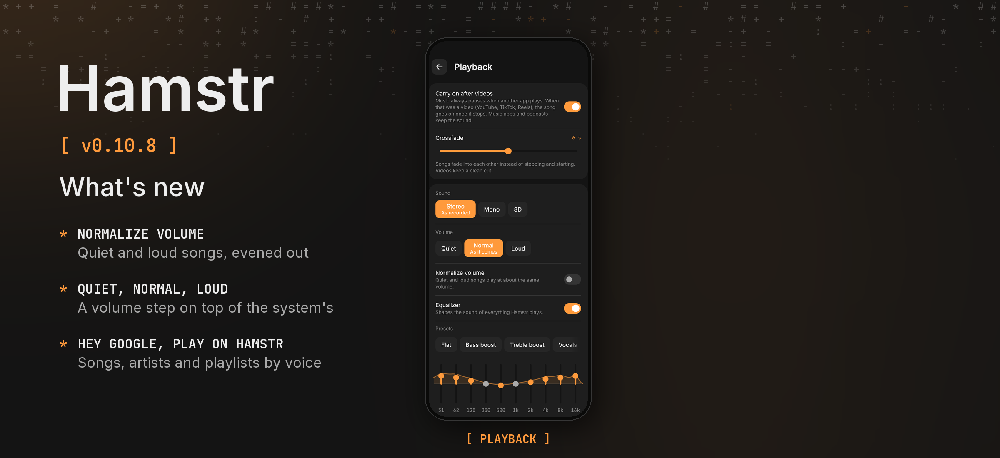

Hamstr 0.10.8 evens out loud and quiet songs, adds a volume step and plays your downloads when you ask your assistant.

### Phone and computer

- **Normalize volume.** A new switch in Settings › Playback plays quiet and loud songs at about the same volume. Silence and fade-outs stay as they are.
- **Quiet, normal or loud.** *Volume* sits next to *Sound*: *Quiet* plays a little softer, *Loud* louder without clipping.

### Phone

- **Play from your assistant.** Say “Hey Google, play Queen on Hamstr” and Hamstr plays the song, artist or playlist that fits best from your downloads. “Play my music on Hamstr” shuffles all your songs.
- **Clearer what’s new.** The update sheet shows only what changes on the phone, each point with its title.

### Details

Normalizing turns a loud song down quickly and a quiet one up slowly, by at most 12 dB, and a limiter keeps boosted peaks from clipping; it runs in the shared sound chain, so both players do the same. Voice requests come in as Android’s play-from-search intent, or through the media session when an assistant talks to the player directly. When nothing matches, Hamstr opens the library and says so. The song page’s sound button lights up when *Volume* or normalizing is on.

Cheek stays at 0.3.2. Android’s version code increases from 1107 to 1108.

Android and desktop compilation and the automated tests passed locally, including new tests for the volume steps, normalizing, the voice search and the notes format. The changes have not been tried on a physical phone or with a real assistant. The release picture shows the Playback settings as the shared UI tests draw them, because no device or emulator was connected.
