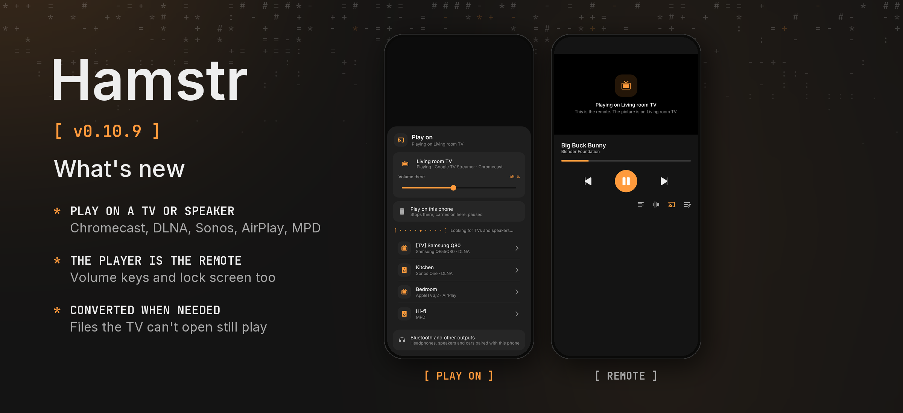

Hamstr 0.10.9 plays your music and videos on the TVs and speakers in your home.

### Phone and computer

- **Play on a TV or speaker.** The new cast button in the player lists what is on the same network: Chromecast and Nest, smart TVs and receivers over DLNA, Sonos, AirPlay and MPD. Pick one and it plays there, with its volume in the same sheet. *Play on this phone* (or *this computer*) brings it back, paused where it was.
- **The player is the remote.** Play, pause, seeking and skipping steer the TV, and the picture’s place says where it is playing. Taps show at once, even before the TV answers.
- **Files the TV doesn’t play still play.** When a device can’t open a file (Opus or WebM on most TVs, MKV, VP9), Hamstr makes a copy it can and sends that; a speaker gets only the sound of a video. The player shows how far the copy is, and the next time it is ready at once.

### Phone

- **Lock screen, notification and volume keys.** While something plays on a TV they steer it too, and the queue goes on there song after song. *Bluetooth and other outputs* opens Android’s own output switcher.

### Details

Hamstr finds devices with SSDP and mDNS and talks to them without Google’s SDK: SOAP for DLNA renderers, the Cast protocol over TLS with the Default Media Receiver, AirPlay’s video protocol and MPD’s text protocol. A small HTTP server on the phone or computer hands the file to the device under a random path, with byte ranges for seeking, and only while it casts. Commands go out on their own queue, apart from the status polls, and of quick taps of one kind only the last is sent. Copies are made with the bundled FFmpeg (sound only, the picture moved into an MP4, or H.264 and AAC) and kept in the cache. AirPlay devices that ask for pairing (newer HomePods and Apple TVs) can’t play yet, and AirPlay has no volume control.

Cheek stays at 0.3.2. Android’s version code increases from 1108 to 1109.

The protocols were tested against fake devices and the conversion with the bundled FFmpeg; compilation and the automated tests passed. Hamstr has not played on a real TV or speaker yet. The release picture shows the sheet and the player as the shared UI tests draw them, because no device or emulator was connected.
