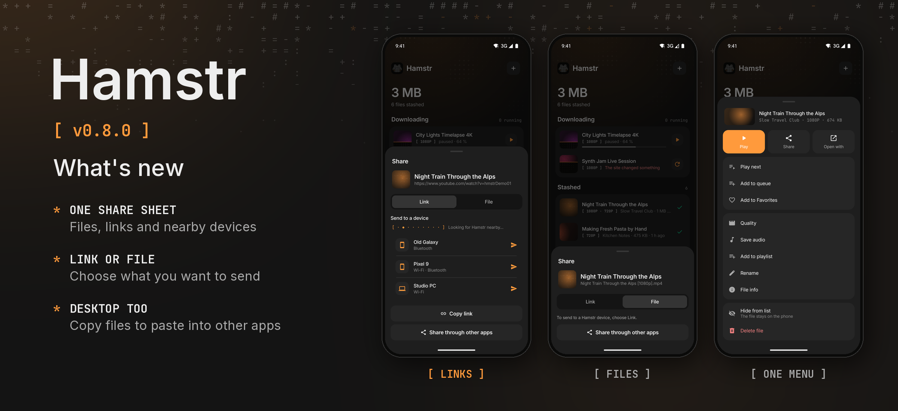

Hamstr 0.8.0 brings sharing into one sheet on the phone and desktop.

- One Share action replaces the separate file sharing, copy-link and send-to-device actions. A preview shows what you are sharing.
- Switch between Link and File for downloaded media. Links that have not been downloaded open in Link mode; imported files and selections of several files open in File mode.
- Nearby Hamstr devices appear directly in Link mode, with sending, sent and queued status beside each device. Switching modes keeps the device order and send status.
- Android shares links or files through the system app picker. The player, library selection and playlist menus use the same sheet.
- On desktop, copy a link or copy the file itself to paste into another app, or show the file in its folder.

Nearby still transfers links, not files. Cheek remains at 0.3.1. This is a minor feature release; Android's version code increases from 806 to 900.
