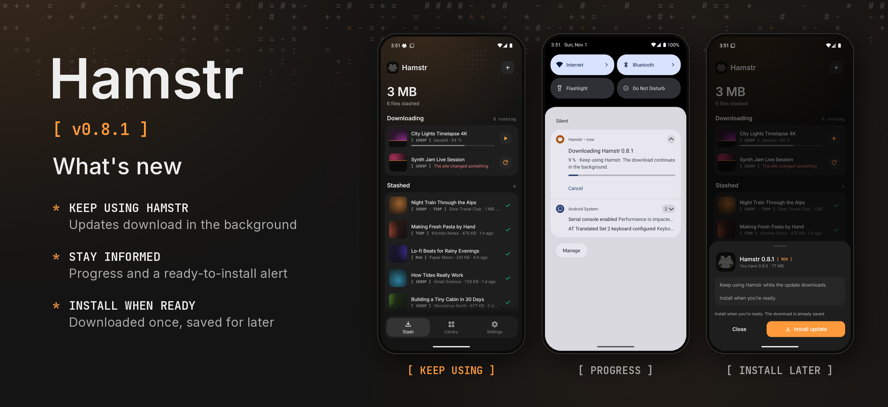

Hamstr 0.8.1 fixes mobile updates keeping you on the download screen.

- Starting an update download closes the sheet. You can keep using Hamstr, switch to another app or turn the screen off while a foreground service finishes the download.
- An update notification shows progress and lets you cancel. When the verified APK is ready, another notification takes you back to the installation screen.
- Installation starts when you choose it, so a finished download does not unexpectedly close the app. The saved APK survives restarting Hamstr and does not need to be downloaded again.
- Interrupted or incomplete downloads can be retried. Package identity and signing-key checks still run before installation.

The new download flow takes effect once 0.8.1 is installed; an older installed version still uses its existing updater to get this release. Desktop packages are included with the same version. Cheek remains at 0.3.1.
