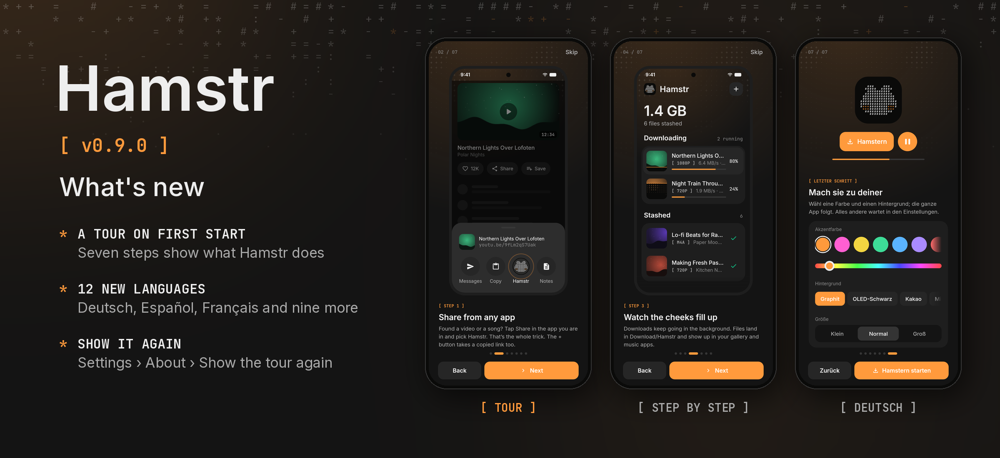

Hamstr 0.9.0 shows you around and speaks your language.

- **A tour on first start.** Seven short steps (six on the computer) show what Hamstr does: share a link from any app (or copy it and press Ctrl+V on the computer), pick video or just the sound, watch downloads arrive, play them, send links between your devices, and pick a colour. The pictures are drawn from the app itself and move like it. Skip it at any time; Settings › About › Show the tour again brings it back.
- **12 new languages:** German, Spanish, French, Italian, Portuguese (Brazil), Dutch, Polish, Turkish, Russian, Japanese, Korean and Chinese (Simplified). Hamstr follows the system language. On Android 13 and later you can also pick a language for Hamstr alone in Settings › Apps › Hamstr › Language.
- The background names in Appearance (Graphite, OLED black …) are translated too.

If you already have downloads, the tour doesn't open by itself after this update; you'll find it in Settings › About. Desktop packages are included with the same version. Cheek remains at 0.3.1.
