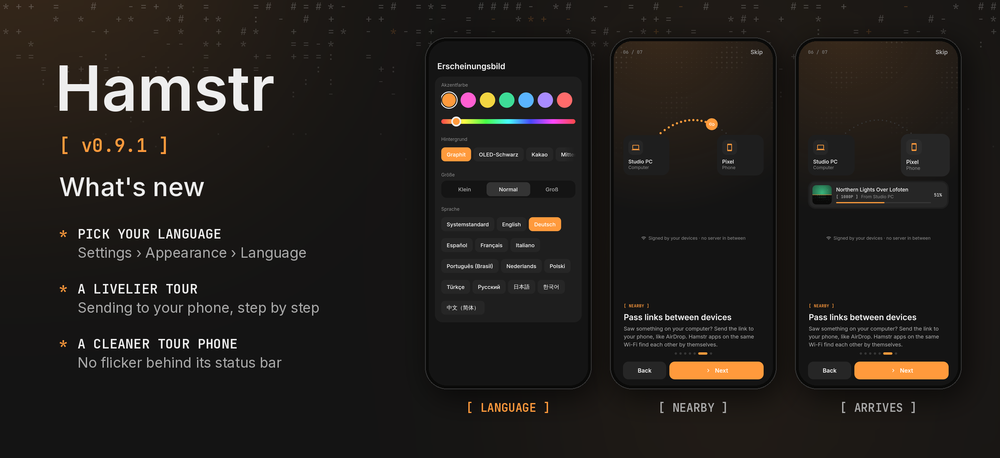

Hamstr 0.9.1 lets you pick its language and polishes the tour.

- **Pick your language.** Settings › Appearance › Language lists every language Hamstr speaks, each in its own words, plus your system's. On the phone and the computer alike, the app switches right away. On Android 13 and later this is the same setting as Settings › Apps › Hamstr › Language.
- **Sending to your phone, shown step by step.** The tour's Nearby page now plays the whole story: your devices find each other, the link flies over, the phone asks once and the download runs to the end.
- **No more flicker in the tour's phone.** The pictured phone and window no longer draw the moving dot pattern behind their status bar.

Desktop packages are included with the same version. Cheek remains at 0.3.1.
