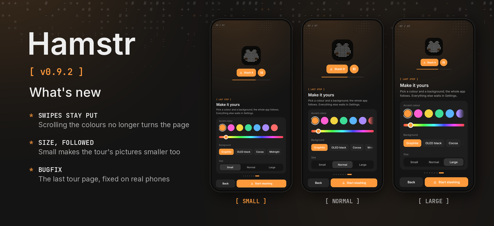

Hamstr 0.9.2 fixes the tour's last page.

- **Scrolling the colours no longer turns the page.** On "Make it yours", a row of colours or backgrounds scrolled to its end used to hand the rest of the swipe to the tour, which jumped back a step. It now stays put.
- **The pictures follow the size.** With Settings › Appearance › Size on Small, the tour's pictures grew instead of shrinking. They now get smaller and larger with everything else.

Desktop packages are included with the same version. Cheek remains at 0.3.1.
