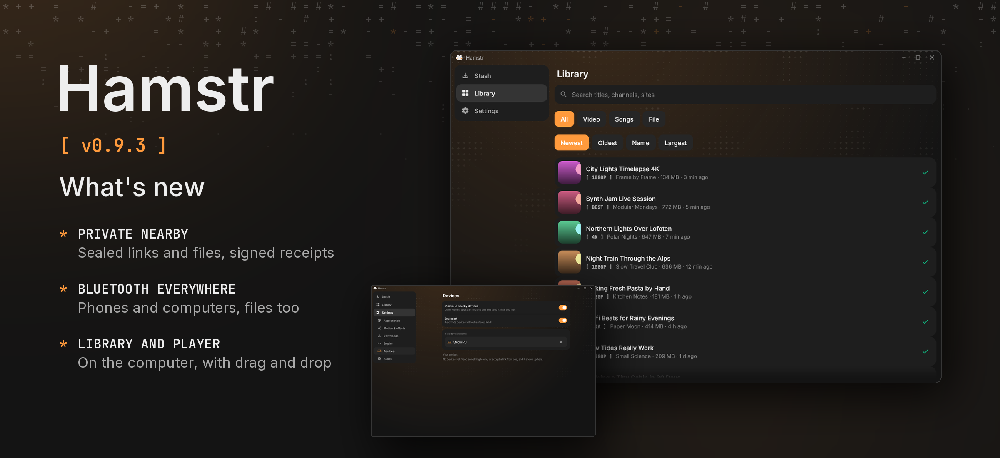

Hamstr 0.9.3 makes Nearby private, brings Bluetooth to the computer, signs every update and adds a library and a player on the computer.

- Nearby sends files too: in the share sheet under *File*, to a Hamstr on the same Wi-Fi or, slower, over Bluetooth. Links and files are sealed so only the device they're for can open them, and a send counts as done only when that device signs for it. Nobody nearby can pass for one of your devices any more. Both devices need 0.9.3; older Hamstrs don't see newer ones.
- The computer finds your phones over Bluetooth too, without a shared Wi-Fi, and they find it (Settings › Devices › Bluetooth). On macOS Hamstr asks for Bluetooth the first time.
- The desktop app has a library with search and plays videos and songs in its own player. Pick quality and format for a link under *Options* in the + sheet, or drop links and files on the window.
- Choose where downloads go: any folder on the computer, a folder inside Download on the phone.
- Whole playlists download through Cheek on the phone too, one video after another; videos finished before a pause aren't fetched again.
- On the computer yt-dlp and Cheek update themselves once a day, like on the phone, and an app update no longer replaces a newer yt-dlp with an older one.
- On Android 14 and later, downloads you start in Hamstr run as one of Android's download jobs and aren't stopped after six hours a day.
- Desktop updates and Cheek updates install only when their release key signed the checksums. A release whose desktop installers are still being built waits instead of reporting a checksum error.
- One damaged or newer entry in the download list no longer empties the whole list; what can't be read is kept aside.
- With Cheek 0.3.2, which comes with this release: encrypted (AES-128) HLS streams, subtitles written into the file, playlists on the computer, and how far ffmpeg is while merging, converting and tagging.

Desktop packages are included with the same version. Cheek is 0.3.2.
