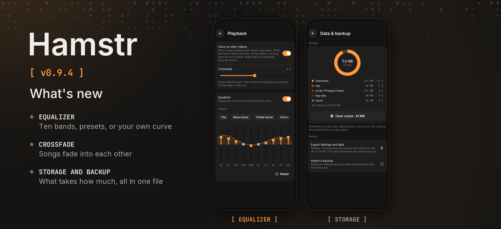

Hamstr 0.9.4 adds an equalizer and crossfade, shows what takes how much space, backs everything up into one file, and makes the player and Nearby easier to reach.

- A ten-band equalizer with presets (bass, treble, vocals, rock, pop, electronic, hip-hop, jazz, classical, acoustic, podcast, late night) or your own curve: grab a band and slide it, the sound follows at once. The same on the phone and the computer, in Settings › Playback and on the song page.
- Crossfade: songs fade into each other over up to 12 seconds instead of stopping and starting (Settings › Playback). Videos, repeat one and the sleep timer's *end of song* keep the clean cut.
- Settings › Data & backup shows in a ring what Hamstr takes up: your downloads, the app, yt-dlp, FFmpeg and Cheek, its data and the cache, with what is left free. The cache can be cleared there.
- Export settings and data: the settings, the download list, playlists and where you left off go into one file, to keep or to take to another phone or computer. Importing it brings the settings back and adds the downloads that aren't there yet; nothing starts downloading by itself. Each device keeps its own name and its Nearby key.
- Swipe a video up in the big player to go fullscreen, and down to leave it, as in video apps. Double tap skips 10 s on the side you tap, shown beside the middle instead of under the play button; more taps add up.
- An A–B loop for practising a part: hold the timeline once for A and again for B, or hold and slide over the part. It keeps looping in the background, on the phone and on the computer.
- Remembered devices show up in Android's share sheet, so a link goes straight to that Hamstr. *Send with Hamstr* is a second entry there for sending instead of stashing.
- Settings › Devices opens each remembered device: whether it's here and how, a link or files to send it, whether it may send without asking, and forgetting it.
- *Open when done* can be picked for a single download in the sheet.
- A hidden file's menu, opened from Settings › Hidden, shows it again.

Desktop packages are included with the same version. Cheek is 0.3.2.
