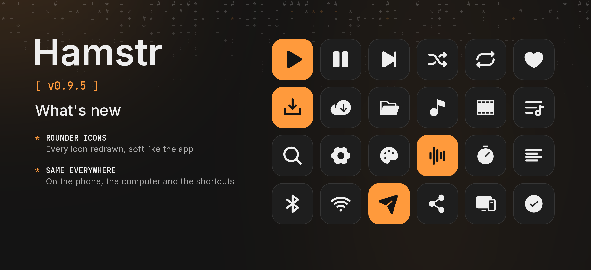

Hamstr 0.9.5 gives every icon the same soft, round shape as the rest of the app.

- All icons are redrawn from [Phosphor](https://phosphoricons.com): round line ends, round corners, no more sharp edges. Some were still the old square Material icons (Bluetooth, repeat, shuffle, send, sort, Wi-Fi, the queue and lyrics buttons, the drag handle); now they all match.
- The same on the phone and the computer, and on the launcher shortcuts (paste, add, library).
- The ten-second skip buttons are drawn new in the same round style.

Desktop packages are included with the same version. Cheek is unchanged.
