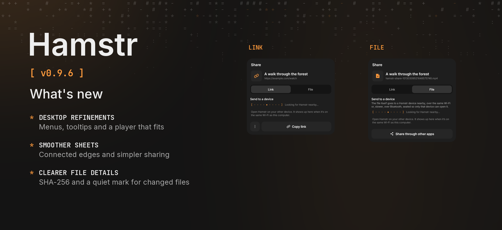

Hamstr 0.9.6 tidies up the desktop and fixes rough edges in the phone's sheets and player.

### Desktop

- Sheets open as centred modals, while a file's actions open in a right-click menu at the pointer. The phone keeps its bottom sheets.
- Custom tooltips explain icon buttons, window controls and the player's volume bar.
- Library filters and sorting sit under a filter button, leaving more room for files.
- Videos fit the window without losing their shape; songs use a compact card with the cover beside the controls.
- Modals dim the whole window consistently, including the title bar. Window controls remain usable.
- Engine settings check for a newer yt-dlp or Cheek version before offering an update.
- A small startup window shows that Hamstr is opening while the main window loads.

### Phone

- Opening a bottom sheet no longer briefly leaves a gap at the bottom of the screen.
- Lyrics stay aligned with the cover area when the player is pulled down. They can also open fullscreen with playback controls.
- Android's share menu has one Hamstr entry again, opening the stash sheet directly.
- The incoming stash sheet has a smaller share button. Outgoing link sharing puts the other-apps button beside Copy link.
- Playlist deletion sits beside editing in the header, with confirmation before anything is deleted.

### File details on both devices

- Finished downloads, imported files and Nearby transfers get a saved SHA-256 hash. A small pencil marks files changed outside Hamstr; file info shows the saved hash and checks the current contents.
- Files saved by older versions get their baseline hash on the first check; their earlier history cannot be reconstructed.
- File info is now available from the desktop's file menu too.

All 13 languages are included. Cheek stays at 0.3.2. This is the requested 0.9.6 patch release; Android's version code increases from 1005 to 1006.

Android and desktop compilation and automated tests passed locally. Phone gestures and playback have not been checked on a physical device. The release picture uses the current shared Compose sharing-dialog test captures because no device or emulator was connected.
