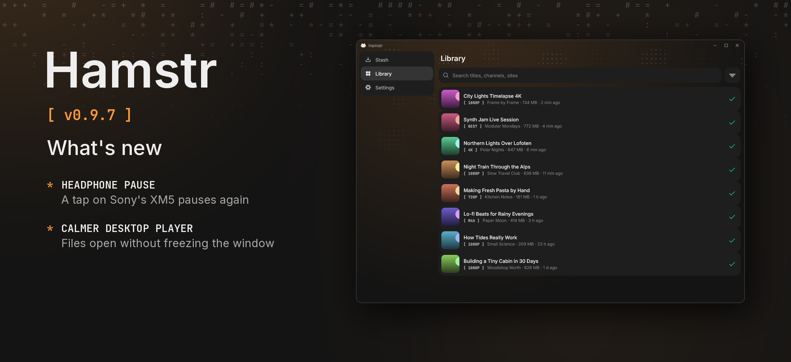

Hamstr 0.9.7 is a bugfix release for headphone controls on the phone and opening files in the desktop player.

### Phone

- Pausing from headphones works again. Some headphones, Sony's WH-1000XM5 among them, send Play or Pause depending on what they think the player is doing; when they thought Hamstr was paused, a tap sent Play into a song that was already playing and nothing happened. Now a Play from outside while music plays pauses it. Skipping forward and back was not affected.

### Desktop

- Opening a file in the player no longer freezes the window while ffprobe reads it.
- A file ffprobe gets stuck on can no longer hold up the player: ffprobe is stopped after 15 seconds.

All 13 languages are included. Cheek stays at 0.3.2. Android's version code increases from 1006 to 1007.

Android and desktop compilation and automated tests passed locally. The headphone fix has not been tried with headphones on a physical phone. The release picture uses a desktop capture from a demo seed because no device or emulator was connected.
