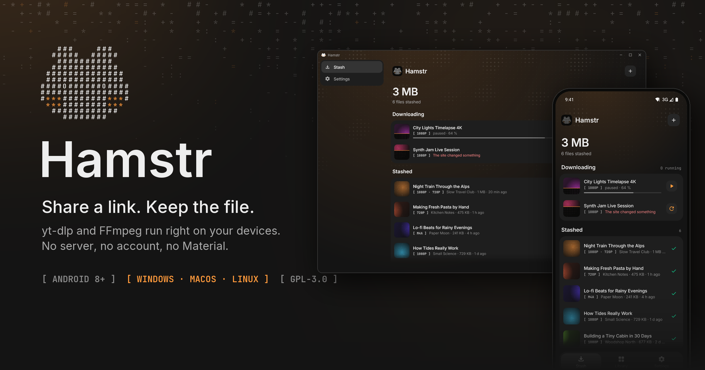
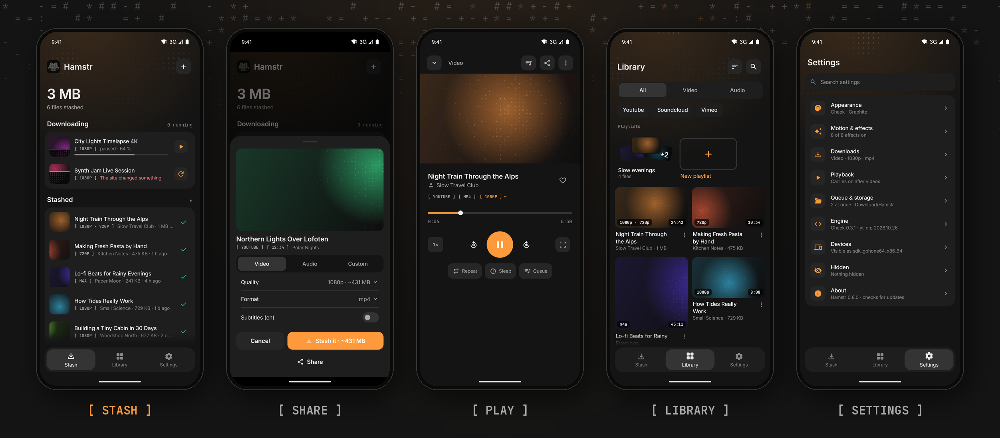
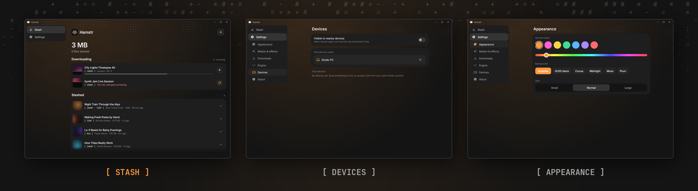

<p align="center">
  
</p>

<p align="center">
  <a href="https://github.com/Mailo037/Hamstr/releases/latest"></a>
  <a href="https://github.com/Mailo037/Hamstr/actions/workflows/build.yml"></a>
  
  
  <a href="LICENSE"></a>
</p>

**Hamstr** stashes videos and music the way a hamster stashes food: share a link from any app, and the file lands on your phone. On a computer, paste the link into Hamstr for Windows, macOS or Linux. [Cheek](https://github.com/Mailo037/cheek) is the default download engine, with [yt-dlp](https://github.com/yt-dlp/yt-dlp) resolving media links and [FFmpeg](https://ffmpeg.org) handling merging and conversion. All three run right on the device, so there is no server in between, no account and no tracking. It works like [Seal](https://github.com/JunkFood02/Seal) or [YTDLnis](https://github.com/deniscerri/ytdlnis), but has a design of its own instead of Material.

<p align="center">
  
</p>

**On your computer** Hamstr looks and works the same: the stash, the settings, Cheek, yt-dlp and FFmpeg built in. Ctrl+V anywhere stashes a copied link. Close the window and it waits in the tray, where downloads keep going and your phone can still send it links.

<p align="center">
  
</p>

## What it does

**Stash**
- Share from YouTube, Instagram, TikTok, SoundCloud, Reddit, X, Twitch and the [1,800+ other sites yt-dlp knows](https://github.com/yt-dlp/yt-dlp/blob/master/supportedsites.md).
- Glyph song, playlist and album links resolve through Cheek, with the existing playlist picker. Official 30-second previews are marked; the public Glyph web player exposes up to 200 songs per share.
- Choose video (up to 4K; mp4, mkv or webm), audio (opus, m4a or mp3) or your own yt-dlp format string. Subtitles and whole playlists are optional.
- Downloads run in a queue with progress notifications. You can pause, resume and retry them, and run up to three at once.
- Cheek fetches supported files and HLS/DASH fragments over parallel connections. Settings › Engine lets you switch to yt-dlp.
- Files go to `Download/Hamstr` (or a folder of your own, Settings › Queue) and show up in every gallery and music app. On a computer they go to `Downloads/Hamstr` or any folder you pick.
- Downloads you start in Hamstr keep going for as long as they need on Android 14 and later, without the daily limit Android sets for background work.
- With *Instant stash* on, sharing starts the download straight away, without the sheet.
- A song that is locked with DRM (Spotify, Apple Music, SoundCloud Go) gets looked up on YouTube Music by title, artist and length, with an offer to stash that one instead. Not the right one? Listen into the other matches and pick it by ear.

**Send**
- See a video on the computer and want it on the phone? *Send to a device* passes the link to another Hamstr nearby, like AirDrop. It's in the + sheet, the share sheet and every download's menu.
- Or send the file itself: in the share sheet under *File*, to a Hamstr on the same Wi-Fi. It lands in that device's stash.
- Hamstr apps on the same Wi-Fi find each other by themselves, and over Bluetooth without one: phones and computers alike. Files go too, slower over Bluetooth.
- The first link from a device asks; *Always allow* lets that device's links go straight into the stash. A link for a device that is away waits until it shows up.
- Every message is signed with the sending device's own key. Nothing goes through a server.

**Play**
- A built-in player for video and audio. Swipe it down and it becomes a mini player above the tabs: swipe it sideways to turn through the queue, pull it down to stop, hold it for the queue.
- A song page like a music app's, tinted by its cover: lyrics that follow along (from LRCLIB or typed in), a sleep timer (after some minutes or at the end of the song), shuffle and repeat.
- A queue: *Play next* and *Add to queue* from any file's menu or a swipe in the songs list, reordered and trimmed in the queue sheet.
- Favorites and your own playlists; drag a file in a playlist by its handle to a new place.
- Music pauses when another app plays and, after a video (YouTube, TikTok), carries on by itself.
- Background audio with media controls, picture-in-picture, fullscreen, and double-tap to skip 10 s.
- A ten-band equalizer with presets (bass, vocals, rock, podcast, late night and more) or your own curve, the same on the phone and the computer. It's in Settings › Playback and on the song page.
- Crossfade: songs fade into each other over up to 12 seconds instead of stopping and starting (Settings › Playback). Videos keep a clean cut.
- An A–B loop for practising a part: hold the timeline once for A and again for B, or hold and slide over the part. It keeps looping in the background; tap the loop under the timeline to end it.
- *Open with…* hands a file to any other app: a video player, a music app, a PDF reader or Word. *Share file* sends the file itself, not the link.
- Keep a video in several qualities: tap the quality in the player to switch between them at the same spot, fetch another one next to it, or replace the current one once the new file is in.
- *Save audio* pulls the sound out of a stashed video on the phone, without downloading it again.

**Feel**
- **Raster** design: calm Slate surfaces with ASCII accents from Glyph.
  - Matrix rain while a link loads.
  - Thumbnails that resolve out of characters.
  - A hamster that blinks, winks and munches when something finishes.
- Drags have weight: the tab pill, switches, sheets and swipe rows stretch with their speed.
- Seven accents plus a custom hue, six backgrounds, three sizes and three mini player styles. The launcher icon (dark, light or accent), its shortcuts, the widgets and the notifications take the accent too. Every effect can be switched off on its own.
- Three widgets: downloads at a glance, what plays with its controls, and the hamster alone to stash a copied link.
- Speaks English, German, Spanish, French, Italian, Portuguese, Dutch, Polish, Turkish, Russian, Japanese, Korean and Chinese, following the system language (on Android 13 and later also per app).
- Files you hide from the library wait in Settings › Hidden, to show again or delete for good.
- Settings › Data & backup shows in a ring what takes how much: your downloads, the app, yt-dlp and FFmpeg, its data and the cache, which you can clear there. Export everything (settings, the download list, playlists, where you left off) into one file and import it on another phone or computer.

**Updates**
- Hamstr checks this repository's releases and installs new versions in place, without a browser detour (Settings › About).
- yt-dlp updates itself once a day, so sites keep working between app releases, on the phone and on the computer.
- Cheek updates itself from [its own releases](https://github.com/Mailo037/cheek/releases) once a day, so a new Cheek doesn't need a new Hamstr. Hamstr takes releases that keep Cheek's command line (same major version, for 0.x the same minor) and that Cheek's release key signed, and falls back to the copy it came with.

## Install

Get the APK from the [latest release](https://github.com/Mailo037/Hamstr/releases/latest):

| File | For |
| --- | --- |
| `Hamstr-x.y.z-arm64-v8a.apk` | Almost every phone from the last years |
| `Hamstr-x.y.z-armeabi-v7a.apk` | Older 32-bit phones |
| `Hamstr-x.y.z-x86_64.apk` | Emulators and Chromebooks |
| `Hamstr-x.y.z-universal.apk` | Any device; bigger, because it carries every ABI |

Android asks once whether your browser may install apps. Later updates come through Hamstr itself.

For your computer:

| File | For |
| --- | --- |
| `Hamstr-x.y.z-windows-x64.exe` | Windows 10 and 11: installs Hamstr for you, with a Start menu entry; no admin rights needed |
| `Hamstr-x.y.z-windows-x64-portable.zip` | Windows without installing: unpack it and start `Hamstr.exe` |
| `Hamstr-x.y.z-macos-arm64.dmg` | Macs with Apple silicon |
| `Hamstr-x.y.z-linux-x64.deb` | Debian, Ubuntu and the like |

The installers aren't signed yet, so Windows SmartScreen (*More info › Run anyway*) and macOS Gatekeeper (right-click › *Open*) ask before the first start. The desktop app updates itself too (Settings › About): it installs the new version and opens again, and only one whose checksums carry Hamstr's release signature. `SHA256SUMS.txt` in each release lists the checksums of every file, `SHA256SUMS.txt.sig` signs them.

On the computer the library lists everything you stashed, with search, and plays videos and songs in Hamstr's own player. Pick quality and format for a link under *Options* in the + sheet, or drop links and files on the window.

## How it works

Cineby/CineSrc movie and episode links, including
`https://cineby.rocks/watch/movie/TMDB_ID`, are resolved on the phone with Android's
built-in WebView. You can also paste `cinesrc:movie:TMDB_ID` or
`cinesrc:tv:TMDB_ID:SEASON:EPISODE` (`cineby:` works too). A series or season link,
such as `https://cineby.rocks/tv/40075?season=2`, opens an episode picker. Select one
episode to see its available qualities, or select several (including the whole
season) to queue them together. Instant stash also opens the picker for these
links. Season 0 supports specials. Hamstr loads the regular CineSrc player,
checks its HLS playlist without transferring browser cookies, then closes the
WebView. Cheek or yt-dlp downloads the stream, with the available qualities shown
in the normal share sheet. No desktop Chrome, remote resolver or extra app is
needed. The provider must expose an accessible stream; resolution times out after
90 seconds. Keep Android System WebView up to date.

```
 share link ──► ShareActivity ──► share sheet ──► DownloadService (foreground, queue)
                                       │                    │
                       yt-dlp metadata             Cheek + ffmpeg (on device)
                       (title, thumbnail, size)             │
                                                   Download/Hamstr + MediaStore
                                                            │
                                     player (Media3) · Open with · Share file

 Settings › About ──► GitHub Releases API ──► APK for this ABI ──► PackageInstaller
```

yt-dlp resolves links once, in a Python process that stays running for a few minutes so the next link skips its start. Cheek picks the streams from that JSON by yt-dlp's rules and downloads them by default; direct files, HLS playlists and plain pages that no yt-dlp extractor knows, Cheek resolves itself, without Python. A playlist goes one video at a time: yt-dlp lists it and resolves each video just before Cheek downloads it. Custom formats, subtitles with a Cheek before 0.3.2 and unsupported download protocols fall back to yt-dlp. FFmpeg merges streams and converts audio when needed.

## License

Hamstr is licensed under the [GPL-3.0](LICENSE), like youtubedl-android, which it builds on. Bundled third-party work:

- yt-dlp ([Unlicense](https://github.com/yt-dlp/yt-dlp/blob/master/LICENSE))
- Cheek ([Unlicense](https://github.com/Mailo037/cheek/blob/main/LICENSE))
- youtubedl-android ([GPL-3.0](https://github.com/JunkFood02/youtubedl-android/blob/master/LICENSE))
- FFmpeg (LGPL/GPL)
- Inter and JetBrains Mono ([OFL-1.1](licenses/))
- Material Symbols ([Apache-2.0](licenses/Material-Symbols-Apache-2.0.txt))

Only download what you have the right to keep.
