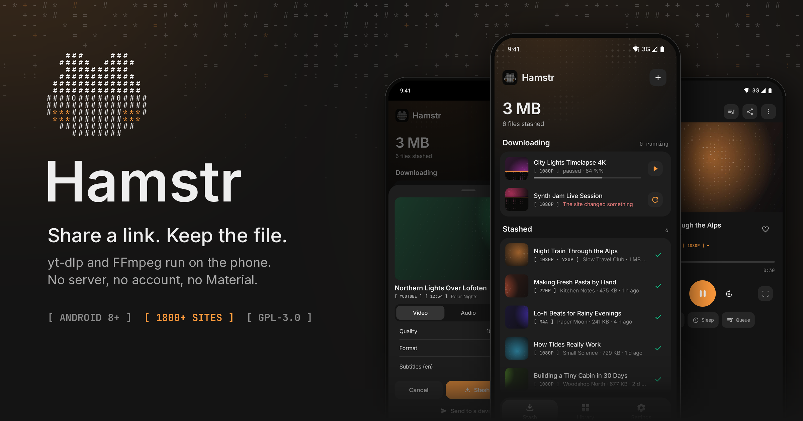
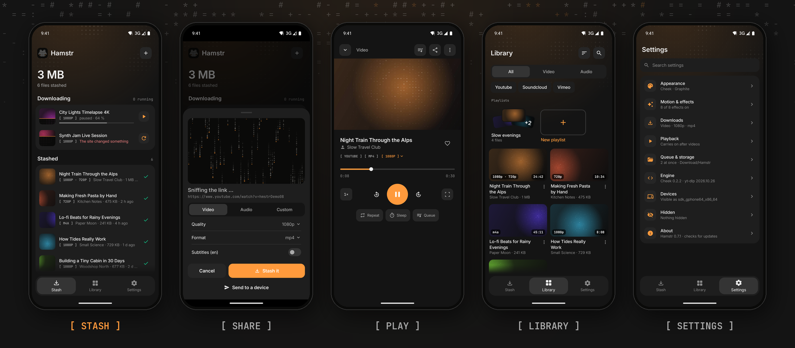

<p align="center">
  
</p>

<p align="center">
  <a href="https://github.com/Mailo037/Hamstr/releases/latest"></a>
  <a href="https://github.com/Mailo037/Hamstr/actions/workflows/build.yml"></a>
  
  <a href="LICENSE"></a>
</p>

**Hamstr** stashes videos and music the way a hamster stashes food: share a link from any app, and the file lands on your phone. [yt-dlp](https://github.com/yt-dlp/yt-dlp) and [FFmpeg](https://ffmpeg.org) run right on the device, so there is no server in between, no account and no tracking. It works like [Seal](https://github.com/JunkFood02/Seal) or [YTDLnis](https://github.com/deniscerri/ytdlnis), but has a design of its own instead of Material.

<p align="center">
  
</p>

## What it does

**Stash**
- Share from YouTube, Instagram, TikTok, SoundCloud, Reddit, X, Twitch and the [1,800+ other sites yt-dlp knows](https://github.com/yt-dlp/yt-dlp/blob/master/supportedsites.md).
- Choose video (up to 4K; mp4, mkv or webm), audio (opus, m4a or mp3) or your own yt-dlp format string. Subtitles and whole playlists are optional.
- Downloads run in a queue with progress notifications. You can pause, resume and retry them, and run up to three at once.
- Files go to `Download/Hamstr` and show up in every gallery and music app.
- With *Instant stash* on, sharing starts the download straight away, without the sheet.

**Play**
- A built-in player for video and audio. Swipe it down and it becomes a mini player that floats above the tabs.
- Background audio with media controls, picture-in-picture, fullscreen, and double-tap to skip 10 s.
- *Open with…* hands a file to any other app: a video player, a music app, a PDF reader or Word. *Share file* sends the file itself, not the link.

**Feel**
- **Raster** design: calm Slate surfaces with ASCII accents from Glyph.
  - Matrix rain while a link loads.
  - Thumbnails that resolve out of characters.
  - A hamster that blinks, winks and munches when something finishes.
- Drags have weight: the tab pill, switches, sheets and swipe rows stretch with their speed.
- Seven accents plus a custom hue, and three backgrounds (Graphite, OLED black, Cocoa). Every effect can be switched off on its own.

**Updates**
- Hamstr checks this repository's releases and installs new versions in place, without a browser detour (Settings › About).
- yt-dlp updates itself once a day, so sites keep working between app releases.

## Install

Get the APK from the [latest release](https://github.com/Mailo037/Hamstr/releases/latest):

| File | For |
| --- | --- |
| `Hamstr-x.y.z-arm64-v8a.apk` | Almost every phone from the last years |
| `Hamstr-x.y.z-armeabi-v7a.apk` | Older 32-bit phones |
| `Hamstr-x.y.z-x86_64.apk` | Emulators and Chromebooks |
| `Hamstr-x.y.z-universal.apk` | Any device; bigger, because it carries every ABI |

Android asks once whether your browser may install apps. Later updates come through Hamstr itself. `SHA256SUMS.txt` in each release lists the checksums.

## How it works

```
 share link ──► ShareActivity ──► share sheet ──► DownloadService (foreground, queue)
                                       │                    │
                       yt-dlp metadata             yt-dlp + ffmpeg (on device)
                       (title, thumbnail, size)             │
                                                   Download/Hamstr + MediaStore
                                                            │
                                     player (Media3) · Open with · Share file

 Settings › About ──► GitHub Releases API ──► APK for this ABI ──► PackageInstaller
```

- `engine/`: yt-dlp and FFmpeg through [youtubedl-android](https://github.com/JunkFood02/youtubedl-android), the download queue and its notifications.
- `player/`: a Media3 ExoPlayer behind a `MediaSession`, plus the mini player, picture-in-picture and fullscreen.
- `update/`: the self-updater, built on GitHub Releases and `PackageInstaller` sessions.
- `ui/`: Compose Foundation only, no Material components. The tokens live in `ui/theme`, the motion helpers in `ui/components`.

## Build

You need JDK 21 and the Android SDK with platform 37.

```bash
./gradlew assembleDebug
```

To test with the pinned, published Cheek binaries even when `local.properties` sets `cheek.dir`, use `./gradlew assembleDebug -Pcheek.useRelease=true`. Downloaded Cheek binaries are checked against the release's `SHA256SUMS.txt` before packaging.

The APKs end up in `app/build/outputs/apk/debug/`, one per ABI plus a universal one.

## Releasing

Push a tag and GitHub Actions does the rest:

```bash
git tag v0.2.0
git push origin v0.2.0
```

[`release.yml`](.github/workflows/release.yml) builds the APKs, signs them with the release key and publishes the release with checksums. The version comes from the tag. If `.github/release-notes/v0.2.0.md` exists, it becomes the release text; otherwise GitHub writes notes from the commits. Every app that is already installed finds the release on its next start.

The key comes from four repository secrets: `HAMSTR_KEYSTORE_B64`, `HAMSTR_KEYSTORE_PASSWORD`, `HAMSTR_KEY_ALIAS` and `HAMSTR_KEY_PASSWORD`. Local release builds read the same values from `signing/keystore.properties`, which git ignores. Keep that key safe: an update only installs over an app signed with the same key.

## License

Hamstr is licensed under the [GPL-3.0](LICENSE), like youtubedl-android, which it builds on. Bundled third-party work:

- yt-dlp ([Unlicense](https://github.com/yt-dlp/yt-dlp/blob/master/LICENSE))
- youtubedl-android ([GPL-3.0](https://github.com/JunkFood02/youtubedl-android/blob/master/LICENSE))
- FFmpeg (LGPL/GPL)
- Inter and JetBrains Mono ([OFL-1.1](licenses/))
- Material Symbols ([Apache-2.0](licenses/Material-Symbols-Apache-2.0.txt))

Only download what you have the right to keep.
